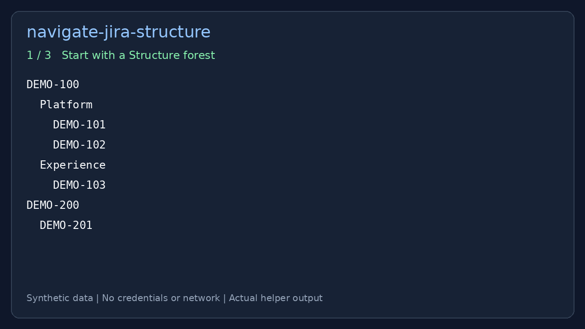

# navigate-jira-structure

**Let Claude Code and Cursor navigate your Jira Structure hierarchy.**

An agent skill for [Claude Code](https://docs.claude.com/en/docs/claude-code)
and [Cursor](https://cursor.com) that adds Tempo / ALM Works Structure-specific
hierarchy traversal alongside your Jira MCP tools. Fetch a board's ordered
forest, focus on an initiative's subtree, and preserve its grouping and order.
Jira Cloud is the default; Data Center / Server is available with `--target dc`.

## See it in action



Try the offline demo with Python 3 — no Jira account, tokens, or dependencies:

```bash
git clone https://github.com/ssrselvamraju/navigate-jira-structure.git
cd navigate-jira-structure
python3 examples/demo.py
```

The demo runs the real subtree extraction helper on a synthetic forest.
It selects `DEMO-100`, returns its issues grouped by bucket, and excludes the
next initiative. Group names and issue keys are prefilled; this is an offline
example, not a recording of a live agent or a Cloud API response.
See [the demo walkthrough](examples/README.md) for output and a live command.

## What you can ask your agent

After installing the skill and configuring credentials:

- “Open this Structure board and show the subtree under issue ID 100.”
- “List the issue keys under this anchor, preserving Structure order.”
- “On Data Center, resolve the custom-field grouping names and list issues
  under each bucket.”

Structure hierarchy can differ from Jira's native parent/child links. This
skill uses the board's row order and depth; your Jira MCP can then fetch issue
fields or perform separately requested updates. The helper does not require
an MCP server to fetch or traverse a forest.

## Supported workflows

| Capability | Jira Cloud (default) | Data Center / Server |
| --- | --- | --- |
| Fetch forest by board URL or structure ID | Yes | Yes |
| Look up a structure by name | Yes | No |
| Extract an anchor subtree | Yes | Yes |
| Resolve numeric issue IDs to Jira keys | Yes, with `--resolve-issues` | Yes, with `--resolve-issues` |
| Resolve custom-field grouping names | No | Yes, with `--resolve-names` |
| Reason over a supplied forest export | Yes | Yes |

See [SKILL.md](SKILL.md) for agent instructions and
[REST details and limitations](references/structure-rest.md) for API behavior.

## Setup

Clone the repository using the command above, then run setup from its directory.
Python 3 is required; the helper scripts use the standard library.

1. **Load the skill**
   Copy or symlink this directory into your tool's skills folder, e.g. for
   Cursor:

   ```bash
   mkdir -p ~/.cursor/skills
   ln -s /path/to/navigate-jira-structure ~/.cursor/skills/navigate-jira-structure
   ```

   Reload your editor/agent so the skill is picked up.

For Claude Code, copy or symlink the repository into
   `~/.claude/skills/navigate-jira-structure` instead.

2. **Jira credentials for the helper script**
   The script reads credentials from environment variables, optionally
   loaded from a `.env` file next to this README. Two ways to set it up:

   - **Interactive** (recommended for a first run):
     ```bash
     python3 scripts/setup.py
     ```
     Prompts for your target (`cloud` by default, or `dc`) and the matching
     values, then writes `.env` for you. Never echoes a token back to the
     terminal.
   - **Manual**: copy `.env.example` to `.env` and fill in your values by
     hand (see [Environment variables](#environment-variables) below).

   **Do not commit `.env`.** It's gitignored; run `git status` before every
   push and confirm it's not listed as a new tracked file.

3. **Optional: shell env instead of a file**
   You can `export` the same variables in your shell instead of using
   `.env`. Shell variables take precedence over the file when both are set.

## Credentials and data

Keep tokens in your local environment or gitignored `.env`; never paste them
into prompts or commit them. The helper sends requests to the configured
Structure and Jira hosts using your credentials. Forest exports and resolved
issue keys may contain private work data; review them before sharing or
providing them to an agent. Use credentials with access only to the boards
and issues you intend to read.

## Environment variables

The helper script's `--target {cloud,dc}` flag (default `cloud`) selects one
full set of credentials below -- never mix `dc` and `cloud` values. See
`SKILL.md`'s "Handoff to a Jira MCP" section and
[references/structure-rest.md](references/structure-rest.md) for
endpoint-level detail.

### Cloud (`--target cloud`, default)

All five required together (no defaults exist for any of these -- a missing
Cloud value fails hard rather than silently falling back to a stale value):

- `STRUCTURE_CLOUD_BASE_URL`: `https://api.structure.app/v1` (Americas) --
  a **separate host** from Jira Cloud itself. This host is the same
  regardless of which Jira Cloud tenant you use (confirmed by testing
  against two different tenants).
- `STRUCTURE_CLOUD_TOKEN` -- a **Structure-specific** PAT, tied to one Jira
  tenant. Generate it at
  `https://<your-tenant>.atlassian.net/plugins/servlet/ac/com.almworks.jira.structure/personal-structure-settings`.
  Sent as `Authorization: Bearer <token>`. **Not** the same as
  `JIRA_CLOUD_API_TOKEN`, and **a token from one tenant will not work
  against another** -- confirmed empirically (the same structure id
  resolved to different, unrelated boards across two tenants when reusing
  a token). Regenerate a fresh one per tenant.
- `JIRA_CLOUD_BASE_URL`: your Jira Cloud tenant, e.g.
  `https://your-company.atlassian.net`.
- `JIRA_CLOUD_EMAIL` and `JIRA_CLOUD_API_TOKEN` -- Atlassian account email +
  API token (from [id.atlassian.com/manage-profile/security/api-tokens](https://id.atlassian.com/manage-profile/security/api-tokens)),
  sent as HTTP **Basic** auth, used for `--resolve-issues`.

**Status:** `--target cloud` is implemented and verified end-to-end against
two live Cloud tenants -- forest fetch, structure metadata, structure-name
lookup, and issue-key resolution all confirmed working. See
[references/structure-rest.md](references/structure-rest.md) for the
confirmed endpoint shapes (Cloud's forest is a nested JSON tree via `POST`,
not DC's flat `formula` string via `GET`).

Two different kinds of validation were done, and it's worth being precise
about which:
- A small board (87 rows) had its exact row count independently
  cross-checked against a teammate's manually-reported figure -- a true
  count match.
- A production-sized board (5,968 rows across 6 nesting levels) returned in
  a single `POST` response with no pagination cursor or truncation
  observed, and its structure was validated by sampling issue types at each
  depth and confirming they match the board's own documented hierarchy --
  but the exact row count was **not** independently cross-counted against
  the Structure UI at that scale (impractical by hand).

Genuinely unverified: behavior at or near Structure's own documented
30,000-issue-per-structure cap (see its vendor migration notes), and
real production Cloud credentials beyond the two tenants tested so far.

### Data Center / Server (`--target dc`)

- `JIRA_URL` (example: `https://jira.example.com`) -- **required**, no
  default is assumed.
- `JIRA_PERSONAL_TOKEN` (PAT for REST, **Bearer** auth)

### `.env` file details

`scripts/fetch_structure_forest.py` loads `.env` automatically if it
exists next to this README (KEY=VALUE format). Environment variables
already set in your shell take precedence over the file. Use
`--env-file /path/to/file` to point at a different file.

## Usage

### Fetch a forest (Cloud, default)

```bash
export STRUCTURE_CLOUD_BASE_URL="https://api.structure.app/v1"
export STRUCTURE_CLOUD_TOKEN="your-structure-cloud-pat"
export JIRA_CLOUD_BASE_URL="https://your-company.atlassian.net"
export JIRA_CLOUD_EMAIL="you@example.com"
export JIRA_CLOUD_API_TOKEN="your-jira-cloud-api-token"

python3 scripts/fetch_structure_forest.py \
  --url 'https://your-company.atlassian.net/jira/apps/<appId>/<installId>/structure/board/67890'
# or: --structure-id 67890
# or: --structure-name 'My Board'
```

### Fetch a forest (Data Center / Server)

```bash
export JIRA_URL="https://jira.example.com"
export JIRA_PERSONAL_TOKEN="your-pat"

python3 scripts/fetch_structure_forest.py --target dc \
  --url 'https://jira.example.com/secure/StructureBoard.jspa?s=12345'

python3 scripts/fetch_structure_forest.py --target dc --structure-id 12345 --out /tmp/forest.json
```

Cloud structure ids are a separate id space from DC's -- don't assume a DC
id and a Cloud id for "the same" board are related.

**Defaults:** The script does **not** resolve Jira issue ids to keys (only two
Structure REST calls for metadata + forest). Issue rows use **numeric ids** as
`key` unless you pass **`--resolve-issues`** (adds one Jira GET per distinct
issue id; can hit rate limits on large boards -- the script retries once with
bounded backoff on HTTP 429).

Writes JSON with `target`, `structureId`, optional `structureName`,
**`formulaRaw`** (raw vendor formula string for debugging), `rows` (each with
`key`, `depth`, and optional metadata), and `forestMeta`. Rows are suitable
for traversal and for **`normalize_forest.py`** (extra fields on each row are
ignored by that script).

Options:

- **`--target {cloud,dc}`** -- select host+auth pair for Structure and Jira
  issue-resolution together (default `cloud`, or `$JIRA_TARGET`;
  auto-inferred from `--url`'s shape when neither is given). Never mix a
  Cloud-sourced numeric issue id with a DC issue-key lookup or vice versa.
- **`--structure-name NAME`** -- Cloud only: resolve a structure by name instead of a
  numeric id (structure ids may not survive a DC->Cloud migration; treat
  `--structure-id` as a per-target cache, not a portable identifier).
- **`--resolve-issues`** -- map numeric ids to issue keys via Jira REST (many
  calls).
- **`--resolve-names`** -- resolve custom-field-option grouping rows (e.g. an
  S-JQL generator grouping by a "Leg" field) to their display text via Jira's
  `customFieldOption` REST, added as a `name` field (DC only; verified live).
  Plain folder/generator rows (not a custom-field grouping) still have no
  resolvable name.
- **`--best-effort`** -- with `--resolve-issues`/`--resolve-names`, skip a
  single unresolvable id (deleted issue, deleted custom-field option) with a
  stderr warning instead of aborting the whole run. Off by default --
  existing behavior (any failure exits non-zero) is unchanged.
- **`--anchor-issue-id ID`** / **`--anchor-row-id ROWID`** -- narrow output to
  one row's subtree (everything nested under it, per Structure's depth
  rule). Pass at most one. Prefer `--anchor-issue-id`: it's resolved fresh
  against this call's own forest fetch, so it can't go stale the way a
  `rowId` from an earlier call can. If the issue occupies more than one row,
  the script errors and lists every occurrence so you can retry with
  `--anchor-row-id`. Combined with `--resolve-names`, also returns `groups`:
  each immediate Leg/bucket header's resolved name mapped to its issue keys
  -- live-verified against a 21,810-row production board, reproducing by
  hand what previously took manually slicing the full forest.
- **`--structure-only`** -- skip building `rows`; output `formulaRaw`,
  `forestMeta`, and empty `rows` (minimal API use, small file).
- **`--exclude-non-issues`** -- drop generator/folder rows (can break depth
  ordering relative to the full Structure UI).

If REST fails, paste a manual export or automation text; the skill still
supports those modes.

### Validate a forest export (depth sanity check)

```bash
python3 scripts/normalize_forest.py /path/to/forest.json
```

Input format (minimal):

```json
{
  "rows": [
    {"key": "PROJ-1", "depth": 0},
    {"key": "PROJ-2", "depth": 1}
  ]
}
```

You can pass the full JSON file produced by `fetch_structure_forest.py`; only
`rows[].key` and `rows[].depth` are used.

Depth must increase by at most one between consecutive rows; first row is
typically depth 0.

## Feedback and contributions

Trying this on a new board? [Open an issue](https://github.com/ssrselvamraju/navigate-jira-structure/issues)
with your target (Cloud or Data Center), the command used, and expected versus
actual behavior. Remove tokens, tenant URLs, and private issue data; a small
synthetic forest is ideal for reproducing traversal problems. Pull requests
for reproducible fixes and documentation improvements are welcome.

## License

Apache License 2.0 -- see [LICENSE](LICENSE) and [NOTICE](NOTICE).
